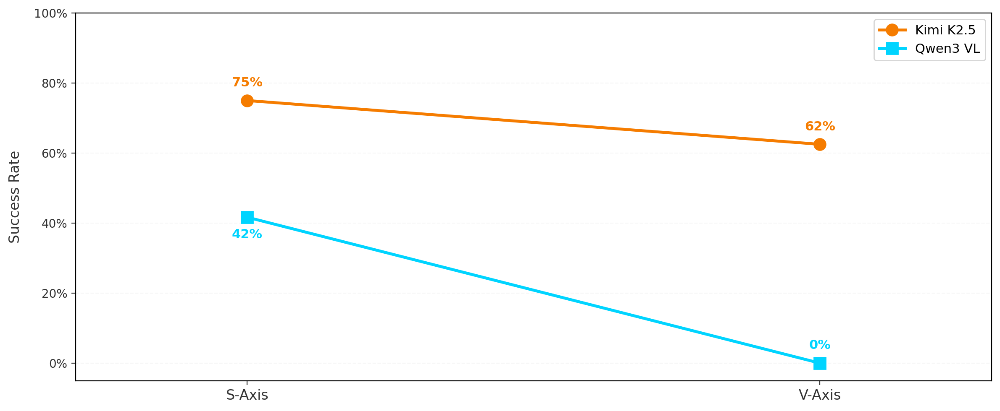
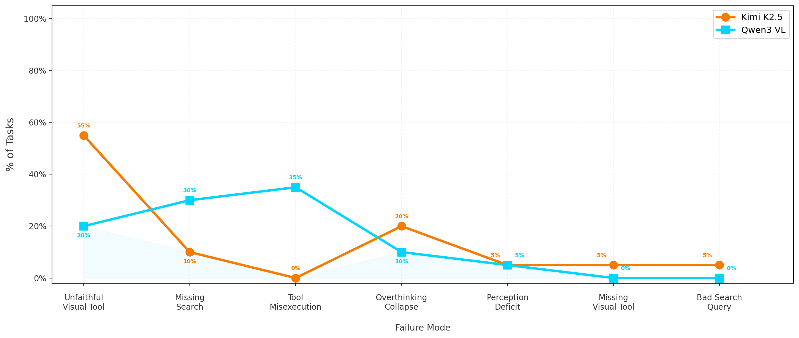

<div align="center">

# JANUS

**Multimodal Agentic Capabilities**

_Can AI agents actively manipulate images and search the web to solve complex visual reasoning tasks?_

by [Ethara AI](https://www.ethara.ai)

<br />

[](https://arxiv.org/abs/2604.03016)
[](https://projects.ethara.ai/janus)
[](https://huggingface.co/datasets/ethara/Janus)
[](LICENSE)

`60 domains`  ·  `17 tools`  ·  `2,000+ checkpoints`  ·  `L1 · L2 · L3`

</div>

---

**Contents**  ·  [Overview](#overview)  ·  [At a glance](#at-a-glance)  ·  [Repository](#repository)  ·  [Methodology](#methodology)  ·  [Environment loop](#environment-loop)  ·  [Tools](#tools)  ·  [Explore](#explore)  ·  [Quick start](#quick-start)  ·  [Resources](#resources)

---

<a id="overview"></a>
## §01 · Overview

Janus is a reinforcement learning environment for training multimodal agents to solve visual reasoning tasks through tool use. Each instance provides a high-resolution image, a question that cannot be answered without acting on the visual input, and a set of 17 tools spanning image manipulation and web search.

Reward signals are generated using 2,000+ stepwise checkpoints that decompose performance into search correctness, visual operation accuracy, and efficiency. The environment covers 60 domains across three difficulty levels (L1, L2, L3), and is built on the Agentic-MME methodology.

<a id="at-a-glance"></a>
## §02 · Environment at a glance

|  |  |
| --- | --- |
| Domains | 60 |
| Tools | 17 (14 image manipulation, 3 retrieval) |
| Checkpoints | 2,000+ stepwise verification points |
| Difficulty levels | L1, L2, L3 |
| Methodology | Agentic-MME |
| License | MIT |

<a id="repository"></a>
## §03 · Repository structure

Janus ships as a set of pinned Git submodules. Each addresses one concern in the training loop.

| Submodule | Purpose |
| --- | --- |
| [`harness/`](harness/) | Agentic-MME benchmark runner: run scripts, evaluators, and configs |
| [`dataset/`](dataset/) | Task bundles: images, questions, golden answers, and checkpoint annotations |
| [`trajectories/`](trajectories/) | Rollout traces from evaluation runs, used for analysis and replay |
| [`delivery/`](delivery/) | Packaged release artifacts for downstream consumers |

Clone with `--recurse-submodules` to fetch all four. See [Quick start](#quick-start).

<a id="methodology"></a>
## §04 · Methodology

Janus follows four measurement principles drawn from the Agentic-MME framework.

**1. Dual-axis process verification.** Every trajectory is scored on two independent axes.

- **S-axis (Strategy)** audits Knowledge Expansion: search keywords, reference URLs, and expected intermediate answers.
- **V-axis (Visual Evidence)** audits Visual Expansion: tool intent (`V_tool`) and artifact faithfulness (`V_true`).

Axis scores are the fraction of passed checkpoints on that axis.

**2. Final answer accuracy.** Answers are graded by normalized exact match against golden answers. Supported match types: exact string, substring contains, and numeric with tolerance. Standardization removes assessment ambiguity.

**3. Overthink metric.** Efficiency is measured against human reference traces.

```
Overthink = max(0, C_agent − C_human) / (C_human + 1)
```

Reference traces average 2 to 3 tool calls per task; the environment caps tool calls at 5 to 7 per instance.

**4. Correctness gating.** Processed images must pass VLM-judge verification. An any-pass mechanism advances a checkpoint if any artifact contains the required evidence. Incorrect visual manipulations are penalized through `V_true` scoring.

<a id="environment-loop"></a>
## §05 · Environment loop

Each instance runs through three stages.

**Step 01 · Investigate and manipulate.** The agent receives an image alongside a task that requires active visual manipulation. It identifies the correct region, orientation, or enhancement and localizes visual evidence through crop, rotate, flip, or enhance operations.

**Step 02 · Expand and retrieve.** When external knowledge is required, the agent coordinates visual cues with open-web search: extracting information from processed images (brand names, years, on-image text), then querying the web for factual context (founding years, headquarters, historical events).

**Step 03 · Verify correctness.** Process-level verification runs on the completed trajectory. The V-axis checks visual tool intent and intermediate artifact faithfulness; the S-axis audits search strategy, keywords, and retrieved information; efficiency is scored by the Overthink metric.

<a id="tools"></a>
## §06 · Tool inventory

Janus exposes 17 tools across two families. Image tools operate on normalized `bbox_2d` coordinates in `[0, 1000]` with the origin at the top-left.

**Image manipulation (visual expansion) · 14 tools**

|  |  |  |
| --- | --- | --- |
| `crop` | `rotate` | `flip` |
| `resize` | `enhance` | `grayscale` |
| `autocontrast` | `blur` | `sharpen` |
| `denoise` | `edge_detect` | `invert` |
| `equalize` | `threshold` |  |

**Retrieval (knowledge expansion) · 3 tools**

| Tool | Purpose |
| --- | --- |
| `google_search` | Web search over textual queries |
| `google_lens_search` | Reverse image search over processed artifacts |
| `fetch_webpage` | Retrieve and parse a webpage by URL |

<a id="explore"></a>
## §07 · Explore the environment

The live dataset viewer is hosted at **[projects.ethara.ai/janus](https://projects.ethara.ai/janus)**, with an interactive instance browser, per-domain filters, and downloadable trajectories.

**Sample instances**

| Instance ID | Domain | Task | Level |
| --- | --- | --- | --- |
| `L2_Aviation_AircraftRegistration_NamesakeBirthYear_0044` | Aviation | Aircraft registration → namesake birth year | L2 |
| `L2_Electronics_TVBrand_Headquarters_0045` | Electronics | TV brand → headquarters city | L2 |
| `L2_Retail_WatchBrand_FoundingYear_0046` | Retail | Watch brand → founding year | L2 |
| `L3_Telecom_WirelessCarrier_ParentCompany_0047` | Telecom | Wireless carrier logo → parent company | L3 |

**Category coverage**

<picture>
  <source media="(prefers-color-scheme: dark)" srcset="assets/17_category_insight_dark.png">
  
</picture>

**Failure mode distribution**

<picture>
  <source media="(prefers-color-scheme: dark)" srcset="assets/failure_line_dark.png">
  
</picture>

<a id="quick-start"></a>
## §08 · Quick start

```bash
git clone --recurse-submodules git@github.com:EtharaOrion/janus-samples.git
cd janus-samples
```

If the repository was cloned without submodules, populate them with:

```bash
git submodule update --init --recursive
```

For environment setup, running experiments, and evaluation, see [`harness/README.md`](harness/README.md).

<a id="resources"></a>
## §09 · Resources and citation

- **Paper (Janus / Agentic-MME):** [arXiv:2604.03016](https://arxiv.org/abs/2604.03016)
- **Dashboard:** [projects.ethara.ai/janus](https://projects.ethara.ai/janus)
- **HuggingFace dataset:** [ethara/Janus](https://huggingface.co/datasets/ethara/Janus)
- **GitHub:** [EtharaOrion/janus-samples](https://github.com/EtharaOrion/janus-samples)

If Janus supports your research, please cite the underlying methodology paper.

```bibtex
@article{wei2026agentic,
  title   = {Agentic-MME: What Agentic Capability Really Brings to Multimodal Intelligence?},
  author  = {Wei, Qianshan and Yang, Yishan and Wang, Siyi and Chen, Jinglin and Wang, Binyu and Wang, Jiaming and Chen, Shuang and Li, Zechen and Shi, Yang and Tang, Yuqi and others},
  journal = {arXiv preprint arXiv:2604.03016},
  year    = {2026}
}
```

---

<div align="center">

Released under the [MIT License](LICENSE)  ·  © 2026 Ethara AI

</div>
